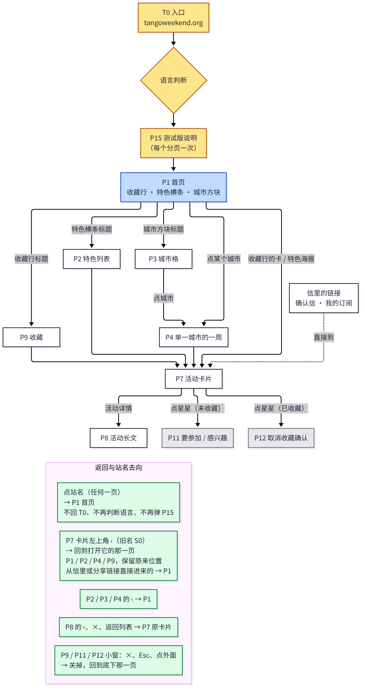
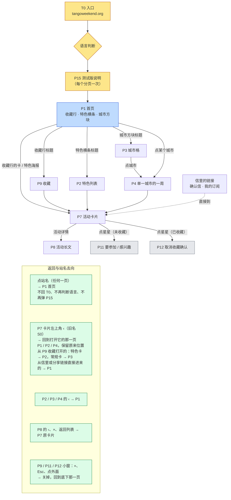
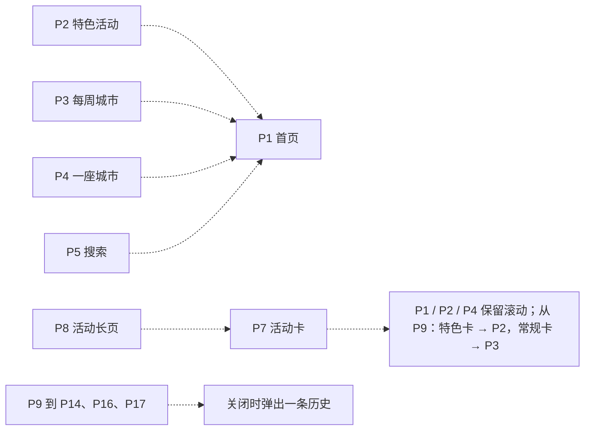

# ATM 导航与交互规格（Navigation & Interaction Spec）

This file did not exist in the repo. It is the navigation and interaction spec for Asia Tango Map. Later sections can be added here. The rules below are the ones for the favorites row and an opened card.

Related intent copy stays in `docs/star-intent-requirements.md`. Where that file and this one differ on unfavorite, this section wins for the favorites row and the opened card.

Visitor-facing Chinese uses 「信息」 for organizer updates and notices.

## 收藏活动行与打开的卡片（Favorites row and opened card）

The favorites row is the homepage block 已收藏 N 个活动 / N saved events (收藏活动). Opening one of its cards goes to that event’s card (`?card=`), featured or regular. The saved-events sheet (我的收藏 / My saved events) is the same row opened as a list.

### Star size

- On the favorites row and on an opened card, the star’s tap target is at least 44×44px.
- That matches the stars on homepage cards and in the saved list.
- The glyph scales with the target (about 26px inside the 44px control) so the opened card does not keep the old 34×34 control and 20px glyph.

### What the star does

- On an opened card that is already saved, the star means 取消收藏 / Remove from favorites. It does not open the Going / Interested sheet, and it does not wait on the organizer-email check.
- On an opened card that is not saved, the star still adds a favorite (the existing intent sheet). That does not ask for confirmation.
- In the saved list, the star and the 取消收藏 / Remove from favorites button both unfavorite. They do not open the intent sheet.

### Confirmation

Unfavorite always asks first. Favorite (adding) does not, unless a later rule in this spec says so.

| | 中文 | English |
|---|---|---|
| Question | 取消收藏这个活动？ | Remove this event from favorites? |
| Confirm | 取消收藏 | Remove from favorites |
| Dismiss | 保留 | Keep |

- 保留, the dimmed backdrop, and Escape leave the favorite in place.
- 取消收藏 removes it. With no session, that is local only. A verified session still uses the existing unfavorite save. This spec does not change the Worker.
- After it is removed, the star on that opened card is the add control again, with no confirm.

## Page numbers (design only)

This section is a design. It does not rename code ids, change routes, or change what a tap does. The names below are the proposed labels. The code keeps `p10freq`, `html.atm-p10`, `#h-feat`, and the rest until a later implementation change.

Chinese and English use the same ids. The language is the path: `/asia/` and `/zh/asia/`. A control’s words change with the path. The route should not.

### What the numbers mean today

The live code never had a single list. A few comments use P2, P4, P5, P10, and S0. Most screens have only a DOM id or a query. Several `p10*` names are helpers on one card, not screens.

| Current name | Real thing | Not a screen |
|---|---|---|
| P2 | The cream bar and ‹ on the inner home lists (`#atm-p2-back`, `#atm-p2-title`, `html.atm-h-inner`) | The bar is chrome for several lists |
| P4 | A comment next to that ‹ (“P2/P4 ‹ always home”) | No view, no id |
| P5 | The saved-events sheet (`.ah-ly`) | |
| P10 | Two different cards. `html.atm-p10` is only the regular or weekly `?card=` layout. A featured `?card=` uses `#atm-single` and does not add `atm-p10`. A homepage comment still calls every opened card “P10” | |
| S0 | A comment for the ‹ on the single-card bar | Same control as the card back, second name |
| `p10freq`, `p10nextDate`, `p10when`, `p10slides`, and the other `p10*` functions | Date, frequency, notice, and poster helpers inside the regular card | Not pages and not jumps |

### Inventory

Paths are the same on `/asia/` and `/zh/asia/` unless a row says otherwise.

#### Screens

| Now | Id | What the person sees | How they get there | Back and close |
|---|---|---|---|---|
| Site root (proposed T0) | `https://tangoweekend.org/` | No map yet. A language bounce | A visit to the host root | See T0 below. Today: `asiaMapLang` wins, otherwise a Chinese browser language goes to `/zh/asia/?from=home`, and anything else goes to `/asia/?from=home`. `?lang=zh` forces Chinese. A hash, or `?full=1`, skips this and opens the Beijing event page |
| Home (proposed P1) | `#atm-home` with an empty hash. `data-view=home`. Class `atm-h-home` | Three blocks, top to bottom: the favorites row 已收藏 N 个活动 / N saved events; the featured strip 特色活动 / Featured events; the city tiles 每周活动 / Weekly events | Open `/asia/` or `/zh/asia/` with none of `card`, `mode`, `city`, `via`, `date`, `q`, `type`, after T0 and the P15 gate | The site title stays the header. `?from=home` is only the marker the site root adds. The map does not read it |
| Featured list | `#h-feat`. Same home root, `data-view=feat`, class `atm-h-inner` | Featured events | Title or › on the home featured block | ‹ is not “always home”. If this hash was opened from home, Back uses `history.back()`. Otherwise it `pushState`s the bare path and re-renders home. Browser Back follows that history |
| Weekly cities | `#h-reg`. `data-view=reg` | City grid for weekly events | › on the home city block | Same ‹ as the featured list |
| One city | `#h-city-<City>`. `data-view=city` | That city’s week | A city tile or chip | Same ‹. Switching city stays on this hash |
| Search | `#h-search`. `data-view=search`, class `atm-h-search` | Chips for type and city | The hash. The header magnifier that used to set it was removed | Same ‹ |
| Filter list | `#filters`, `#china-listings`. Home script returns before painting `#atm-home` | The older map: type, city, dates, then the card list | `?mode=featured` or `?mode=regular`, plus optional `city`, `date` or `from`, `to`, `k`, `via=card`. Also any of `card`, `mode`, `city`, `via`, `date`, `q`, `type` in the query | Title click `pushState`s an empty query and shows the pre-search state. It does not go Back. Browser Back runs `urlApply` and restores the query. A result link to `/event/…` stores `sessionStorage.atmLast` (path, query, scroll, up to one hour) and the return from that event page writes the query back |
| Pre-search | `body.china-presearch` | Filters, no result list | First paint when there is no hash and no `city`, `type`, `id`, `event`, `q`, `from`, `to`, or `mode` | 搜索 leaves this state and writes `?mode=` |
| Regular card | `?card=<id>`, `html.atm-p10`, `#atm-c1bar`, `#atm-single` | Weekly or regular event. `p10freq` is the frequency line. `p10nextDate` is the next date | A poster or a `?card=` link when the event is weekly or a regular one-off | ‹: `history.back()` when the referrer is this site and is not `/organizer/` or `/dj/` and there is history. If the referrer is this site but is an organizer or DJ page, `location.replace` to the list path. Otherwise `location.assign` to `https://tangoweekend.org/` or `/zh/`, which drops the map path. A search button is built and then discarded, so it is not on the bar |
| Featured card | `?card=<id>`, `#atm-single`, class `b-feat`, no `atm-p10` | Featured event | A home or list poster when `kind=event` and it is not a one-off | ‹: `history.back()` only when the referrer is the same path with no `card` and there is history. Otherwise `pathname + '#v-' + id`. On the home, `#v-` is deleted at once, so the person lands on the home, not on that card in a list |
| Missing card | `#atm-single .atm-nf-card` | “暂时没有这张活动卡” / “This card is not on the map” | `?card=` is not in core, events-more, or events.json | 再试一次 / Try again reloads the same URL. ★ 特色活动 goes to `?mode=featured&via=card`, the filter list, not the home featured list |
| Ended featured | `#atm-single .atm-exp` | The card plus an ended stamp, next edition, recap | `?card=` of a featured event whose end is before today | City and featured links use `?mode=…&via=card` |
| Saved sheet | `.ah-ly`. Comment name P5 | 我的收藏 / My saved events | The favorites title or › on the home (`data-fav`) | One history entry `{ahFav:1}`. ×, Esc, and the backdrop call `history.back()`. Browser Back closes it and does not leave an extra entry |
| Legacy favorites row | `.atm-favbar`, `.atm-favgrid` | 我的收藏 above the filter list | Only while the home is not showing (`html.atm-h-on` hides it) and there is at least one saved id | The bar collapses. The flag is `atm_fav_collapsed_v1`. A card opens `?card=` |
| Event article (proposed P8) | `/event/<slug>/` and `/event/<slug>/zh/` | The long event page. Example: `/event/gunsan-2027-sunset-tango-marathon/zh/?from=E116` | 活动详情 / Event details, or a detail URL that already has a `#anchor` | `.atm-dback`: if the referrer is the map (or any same-site page when the bar has `data-back`) and there is history, `history.back()`. Otherwise the map with `?card=<from>`. `from` comes from the query, then `sessionStorage` `atm_from_` + path, then a lookup in events.json. The gold × and 返回列表 / Back to list play a short close animation and then fire that same link. Today a poster link (an `<a href>` to a jpg, png, or webp, often `target="_blank"`) leaves this page and shows the file, on desktop and on mobile. Target: that tap stays on P8 and opens the list poster viewer (`.atm-pv`). × at the top right, a tap outside the image, a downward swipe, Esc, and the browser or phone Back all close it and return to the same scroll position. Pinch-zoom stays available. Posters in the same group swipe left and right. Opening pushes one history entry `{atmPv:1}`, so Back closes the viewer and does not leave the page. The original `href` stays, so with JavaScript off the file still opens |
| Organizer and DJ | `/organizer/…`, `/dj/…` | Those profile pages | Links on a card | The regular-card ‹ will not Back into them |

The city dropdown on the filter list (`.atm-reglist`) is a listbox on that list. It is not its own screen. Esc closes it.

#### Sheets and dialogs

None of these change the path, except the poster viewer.

| Now | Id | What it is | How it opens | Close | History |
|---|---|---|---|---|---|
| Beta notice | `#atm-notice` | Disclaimer. 我知道了，进入网站 / I understand, enter the site | A new tab, until this tab’s `sessionStorage.atmNoticeAck` is set. A reload asks again. Returning from the back-forward cache does not ask again | The button only. Esc and the backdrop do not dismiss it | No |
| Intent | `#atm-star` | Going / Interested / Not Going. Phases inside one sheet: `start` (email and last 4), `register`, `in` (the choice), `saved` | A star that is not the unfavorite control. `?intent=resume` reopens it for that `card` | ×, backdrop, Esc | No. Browser Back leaves the page while the sheet is still conceptually open, because the sheet is not an entry |
| Unfavorite | `#atm-unfav-ask` | 「取消收藏这个活动？」 / “Remove this event from favorites?” | The star on an opened saved card, the star in the saved sheet, or the 取消收藏 / Remove from favorites button | 保留 / Keep, backdrop, Esc. 取消收藏 removes it | No |
| Menu | `#atm-menu` | ☰ | The header button | ×, backdrop, Esc | No |
| Profile | `#tsub-modal` | 订阅 / Subscribe when there is no session. 我的资料 / My profile when `atm_session` is a 64-hex token. 我的订阅 / Your subscription link is a block inside this sheet | Menu 订阅, menu 我的资料, or `#subscribe`. Both menu items call the same open | ×, backdrop, Esc | No |
| Submit event | `#china-suggest-modal` | The suggest form | Menu 提交活动 | Backdrop, the close control, Esc | No |
| Share | `#atm-wx-sheet` | 分享, 复制链接, 刷新 / Share, Copy link, Refresh | Those menu items | 取消 / Cancel. No Esc handler on the sheet | No |
| Poster, list | `.atm-pv` | Full-screen poster | An expanded regular card’s poster, or an on-site image link. Target: a poster on a P8 event article uses this same viewer | × at the top right, 返回卡片 / Back, the title, a tap outside the image, a downward swipe, Esc. All of them `history.back()`. Pinch-zoom stays available. On P8, posters in one group also swipe left and right | Yes. `pushState({atmPv:1})`. Back closes the viewer and restores the scroll on the page underneath |
| Poster, regular card | `#p10-pv` | Full-screen poster on the regular card | A small tap on that poster | × only | No |
| Recap photos | `.atm-rv` | The ended-event photo strip | A recap thumbnail | A click that is not on the image | No |

#### Jumps from letters

| Letter | Address | Where it lands | Logged out |
|---|---|---|---|
| Subscription confirmation | `https://api.tangoweekend.org/social/going/confirm?e=&t=` | An API page. After a successful confirm the button is 去看亚洲探戈地图 / Go to Asia Tango Map and it opens the language home (`/zh/asia/` or `/asia/`), not the card that started the intent. The tab that sent the letter polls `/social/going/await` and stores the session without navigating | This letter is the sign-in |
| Intent that was waiting on that letter | Built only when the confirm row has a card: `?card=<id>&intent=resume&s=<session>` | The card, then the intent sheet. `atm-early.js` stores `s` as `atm_session` and removes it from the address | Without `s`, the card still opens. The sheet is the logged-out form |
| 我的订阅 | `https://api.tangoweekend.org/social/going/enter/<64 hex>` | A short page, 进入我的订阅 / Open my subscription, which POSTs itself. Success redirects to the language map with `?s=<session>#p=<token>`. The map stores the session and stores the pass URL, then removes both from the address | A bad token shows 链接无效。请在「我的资料」里生成新的订阅链接。 / This link does not work. Make a new subscription link from My profile. |
| `#p=<64 hex>` already on the map | The hash alone | The pass URL is saved and the hash is removed. The profile sheet does not open | Same |
| `#subscribe` | On the map | Opens the profile sheet | The sign-in form |
| `?atm_y=<scroll>` | On the return URL stored with a confirm | The page scrolls back, then the parameter is removed | Works with no session |

Logged out, the home favorites row still reads `localStorage.atm_fav_v1`. Unfavorite on this browser only updates that list. The intent sheet can still open. A verified save waits until the letter is opened. 订阅 and 我的资料 are the same sheet: without a session it is the email and last-4 form.

### T0, the entry

T0 is the site root, `https://tangoweekend.org/`, and it sits before P1. It is not a map screen. Its only job is to choose a language and hand the person to the map.

The language choice uses three inputs. On the live root, after the hash and `?full=1` bypass, the order is:

1. `?lang=zh` forces Chinese. No other `?lang=` value is read.
2. `localStorage.asiaMapLang` set to `zh`, or any saved value other than `en` together with a Chinese browser language, goes to Chinese.
3. Otherwise the page is English. A saved `en` stays English even when the browser is Chinese.

Chinese lands on `/zh/asia/`. English lands on `/asia/`.

Target rule: T0 always runs language, then P15 once for this tab, then P1. A deep link does not sit through the home. `?card=`, a confirmation letter, and a 我的订阅 link go straight to their screen (P7, P11, or P10), and P15 is still shown once on that tab if this tab has not dismissed it. P15 stays a per-tab gate (`sessionStorage`). A reload of the same tab asks again. A new tab asks again.

Today’s oddity: a hash on the root, or `?full=1`, skips the language choice and the beta notice and opens the Beijing event page. That is not the target. T0 does not use the hash or `?full=1` as a shortcut around the gate.

### Proposed numbers

T0 is the root. From P1 the order is the path a person walks: home, lists, card, the long article, favorites, profile, then the sheets.

| New | Screen | Replaces |
|---|---|---|
| T0 | Entry at `tangoweekend.org` | The site root bounce. Language, then P15, then P1 |
| P1 | Home. Three blocks: 已收藏 N 个活动, the featured strip, the city tiles | The unnamed home hash |
| P2 | Featured list | `#h-feat`, and the P2 bar while this list is up |
| P3 | Weekly cities | `#h-reg` |
| P4 | One city’s week | `#h-city-<City>`. The old comment “P4” is retired |
| P5 | Search | `#h-search` |
| P6 | Filter list | `?mode=`, `?city=`, `?date=`, `?to=`, `?k=`, `?via=card` |
| P7 | Card | Both today’s featured `?card=` and the regular `html.atm-p10` card. One page, two layouts |
| P8 | Event article | `/event/<slug>/` and its `/zh/` twin |
| P9 | Favorites | Today’s P5 sheet `.ah-ly` |
| P10 | Profile | `#tsub-modal`. Subscribe and 我的资料 stay one sheet |
| P11 | Intent | `#atm-star` |
| P12 | Unfavorite confirm | `#atm-unfav-ask` |
| P13 | Menu | `#atm-menu` |
| P14 | Submit event | `#china-suggest-modal` |
| P15 | Beta notice | `#atm-notice` |
| P16 | Poster | `.atm-pv` and `#p10-pv` become one viewer |
| P17 | Share | `#atm-wx-sheet` |
| P18 | Letter bridge | The API confirm page and the 我的订阅 enter page |

`p10freq` and `p10nextDate` are not given P numbers. In a later code change they would be named as card helpers (`cardFreq`, `cardNextDate`). This document does not rename them.

S0 is not reused. It was a second name for P7’s back control.

### Jump map

Chinese labels are the screen names. The arrows are the target jumps, not a trace of every legacy query.

返回规则见下方「返回规则」一节：每页返回上一层，最后回到 P1。

### 返回规则

Each page returns one level, and the last step is P1. These are the target rules for the site title and the backs drawn in the diagram.

- Tapping the site title on any page goes to P1. It does not return to T0, it does not choose a language again, and it does not show P15 again.
- The P7 ‹, formerly called S0, returns to the screen that opened the card when that screen was P1, P2, or P4, and it keeps that screen’s scroll. A card opened from P9 does not return to P9. Kind decides the list: a featured card (`kind` is `event`, drawn as `.b-feat`, without `html.atm-p10`) goes to P2, the featured list. A regular or weekly card (`html.atm-p10`) goes to P3, the weekly cities. A card opened directly from a letter or a shared link goes to P1 on the language map.
- The ‹ on P2, P3, and P4 goes to P1.
- On P8, the ‹, the ×, and 返回列表 / Back to list all return to that same P7 card.
- The P9, P11, and P12 sheets close with ×, Esc, or the backdrop, and the screen underneath stays where it was.

P5’s forward path is the search hash. It is not one of the three blocks on P1. Its back target is still P1. A sheet’s close pops the one history entry it pushed, which returns to the screen under it. P15 is not in that sheet list: only its button dismisses it.

### Navigation rules

These are the target rules. Where today’s code differs, the next section says so.

1. T0 chooses the language, then P15 once per tab, then P1. P1 is the empty hash on the language map. P2–P5 are hashes on that same document. P6 and P7 are query URLs, because those links are already shared. P8 is its own document. A deep link (`?card=`, a confirmation letter, 我的订阅) skips the home and opens its own screen, with P15 shown once on that tab if it has not been dismissed.
2. ‹ and the browser Back move one step. The site title on any page goes to P1 and does not repeat T0, the language choice, or P15. P2, P3, P4, and P5 return to P1. The P7 ‹ returns to P1, P2, or P4 when that screen opened it, and keeps that scroll. A card opened from P9 does not return to P9: a featured card (`kind` `event`, `.b-feat`, no `html.atm-p10`) goes to P2, and a regular or weekly card (`html.atm-p10`) goes to P3. A card opened from a letter or a shared link goes to P1 on the language map. P8’s ‹, ×, and 返回列表 / Back to list return to that P7 card. P9, P11, and P12 close with ×, Esc, or the backdrop onto the screen underneath.
3. A sheet that covers the page owns one history entry: P9, P10, P11, P12, P13, P14, P16, P17. ×, Esc, and the backdrop pop that entry. They do not add a second one. P15 is the exception: it is a gate, and only its button dismisses it.
4. Language switch keeps the screen. P4 stays on the same city. P7 stays on the same `card`. P6 keeps `mode`, `city`, and the dates. The other language is only `/asia/` versus `/zh/asia/`.
5. Secrets leave the address bar. `s` is stored and removed, as it is today. After `#p=` is stored, P10 opens so the person can see 我的订阅. `intent=resume` opens P7 and then P11.
6. Logged out: P1 and P9 still show this browser’s saved events. P12 still asks, and the removal stays on this browser. P10 is the email and last-4 form. P11 can be filled in, and the intent is saved only after the confirmation letter. A bad 我的订阅 link offers that same email and last-4 sign-in. It does not tell the person to open 我的资料.
7. A confirmation that started on a card returns to that P7 card in the same language. A confirmation that started from the menu returns to P1 in the same language. The button on P18 and the original tab agree.
8. `?from=home` is not a screen and is not required. The root may redirect without it.
9. Chinese and English share every rule above. Only the words on the controls change.

### Inconsistencies in the current code

1. P10 is two cards. Featured `?card=` never gets `html.atm-p10`. Homepage comments still call that featured card P10. `p10freq` and `p10nextDate` add to the noise because they are helpers.
2. The two card backs disagree. The featured ‹ falls through to `#v-<id>`, and the home deletes `#v-` immediately, so the person gets P1 with no scroll to the card. The regular ‹, with no usable referrer, assigns `https://tangoweekend.org/` or `/zh/`, which is not the language map. A Chinese regular card can leave the map entirely.
3. The P2 comment says ‹ always returns home. The code uses `history.back()` when the previous hash was home, and `pushState` otherwise. There is no P4 screen behind the “P2/P4” comment.
4. S0 and the card ‹ are the same control under two names.
5. Browser Back closes the favorites sheet and the list poster viewer. It does not close the menu, profile, intent sheet, unfavorite confirm, suggest form, or the regular-card lightbox. Esc is also missing on the share sheet.
6. In the menu, 订阅 and 我的资料 open the same sheet. After sign-in the 订阅 row still says 订阅.
7. The language switch copies the query and drops the hash. `#h-city-Beijing` and `#h-search` become the other language’s home. The event article stores language in `twLang`. The map stores it in `asiaMapLang`.
8. `?search=1` is removed as soon as it loads, so it cannot be shared and Back cannot restore it. `#v-<id>` is described as a scroll-to-card link and is deleted on the home.
9. The confirmation success button opens the language home, not the card. A new browser that only follows that button never sees `intent=resume`. The original tab can still catch up by polling, so the two browsers do not land in the same place.
10. `#p=` on the map saves the pass URL and does not open 我的资料. The enter page’s job is to sign the person in and show that they are subscribed. The map then shows the home with no sign of that link.
11. The bad-link sentence sends a logged-out person to 我的资料 to mint a new link. 我的资料 needs a session.
12. Posters have two viewers. The list viewer is in history. The regular-card viewer is not. Featured posters do not open a viewer at all.
13. A poster on a P8 event article (`/event/<slug>/` and `/event/<slug>/zh/`, for example Gunsan `?from=E116`) is a link to the image file. A tap leaves the article and shows that file, on desktop and on mobile. The target is the list viewer (`.atm-pv`) in place: ×, a tap outside the image, a downward swipe, Esc, and browser Back close it and keep the article’s scroll; pinch-zoom stays available; posters in the same group swipe left and right; the open pushes `{atmPv:1}`. The `href` remains so the file still opens when JavaScript is off.
14. Shared `?mode=` links skip the home and open the filter list. The missing-card link ★ 特色活动 uses that list too, not the home featured list.
15. T0 does not always reach P1. A hash or `?full=1` on the site root skips the language choice and the P15 gate and opens the Beijing event page. Every other entry uses `asiaMapLang`, `?lang=zh`, or the browser language. The target is language, then P15 once per tab, then P1, with deep links going straight to their screen and still showing P15 once.
